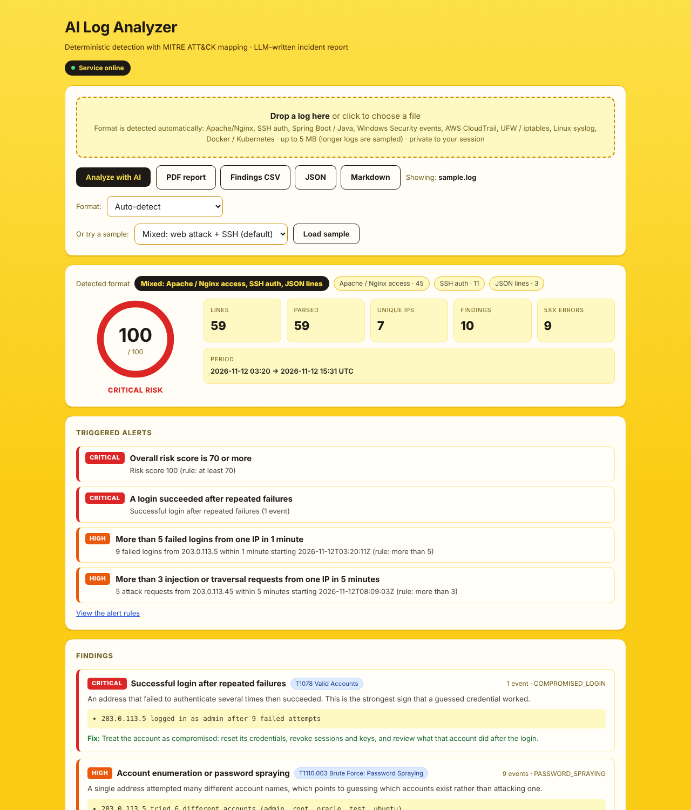
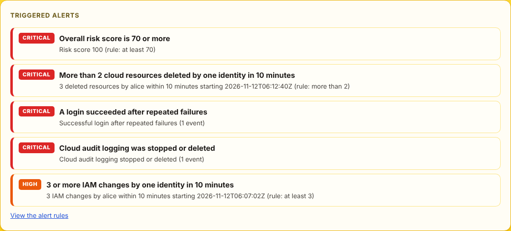
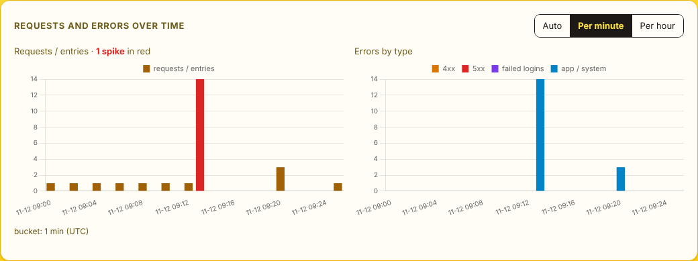
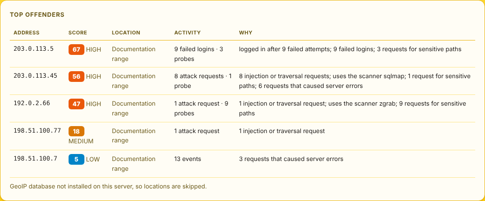
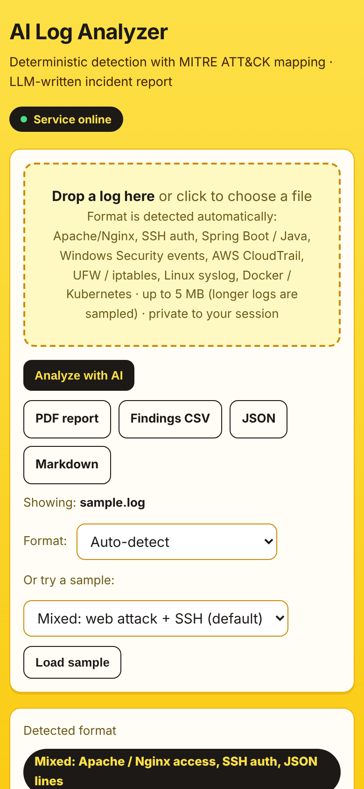
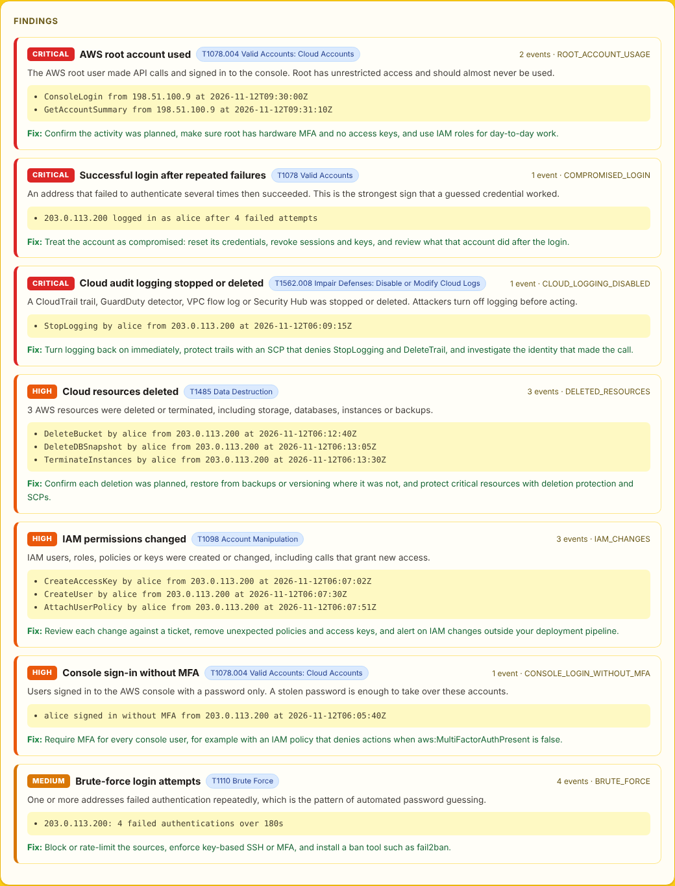
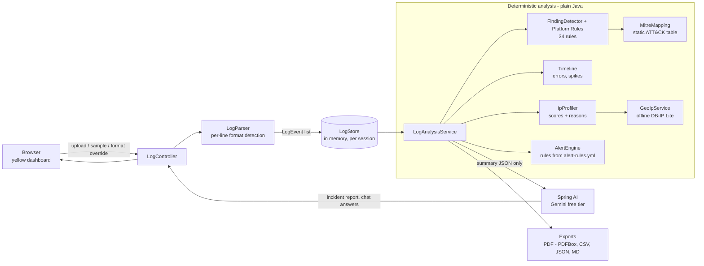

# AI Log Analyzer

[](https://github.com/2307shukla/ai-log-analyzer/actions/workflows/ci.yml)


A security and reliability log analyzer built with **Spring Boot 3** and **Spring AI**. Upload a log in any of nine formats; the app detects the format, finds attacks and failures with deterministic rules, maps each finding to **MITRE ATT&CK**, scores the risk and every suspicious IP (with offline GeoIP), fires configurable alerts, charts errors and spikes over time, and exports a PDF report. An LLM (Google Gemini, free tier) writes the incident report and answers questions about the log, using only the computed findings.

**Live demo:** https://ai-log-analyzer-5l3n.onrender.com  &nbsp;·&nbsp; **API docs:** https://ai-log-analyzer-5l3n.onrender.com/swagger-ui.html
(Free hosting: the first request after a quiet spell can take up to a minute.)

Runs entirely on free tiers: no paid API, no database, no credit card.



---

## Contents

- [Features](#features) · [Screenshots](#screenshots) · [Architecture](#architecture) · [Supported log formats](#supported-log-formats)
- [Detection rules](#detection-rules) · [Analysis features](#analysis-features) · [API](#api)
- [Run locally](#run-locally) · [Deploy free on Render](#deploy-free-on-render) · [Configuration](#configuration)
- [Testing](#testing) · [Security](#security) · [Known limitations](#known-limitations) · [Related project](#related-project) · [License](#license)

---

## Features

- **9 log formats, detected automatically** per line (mixed files work), with a manual override and one sample file per format.
- **34 deterministic detection rules**: brute force, password spraying, break-ins after failed logins, SQLi/XSS/traversal, scanners, sudo/su abuse, new accounts and admin-group changes, cleared audit logs, AWS root use, logins without MFA, IAM changes, deleted resources, disabled logging, port scans, Java exception spikes, ERROR bursts, crash loops and OOM kills.
- **MITRE ATT&CK** technique on every security finding, from one static local table.
- **Severity scoring** (low/medium/high/critical) per finding, per IP and for the whole file.
- **Top offenders** with a 0–100 score, reasons, and country/city from the free offline DB-IP Lite database.
- **Alert rules in YAML/JSON**, e.g. "more than 5 failed logins from one IP in 1 minute", evaluated over sliding windows.
- **Charts** of requests, errors by type and spikes, per minute or per hour (Chart.js, bundled locally).
- **Exports:** PDF (stats, charts, findings, AI report), findings as CSV, JSON and Markdown.
- **AI incident report and chat** grounded in the findings, never the raw log.
- **Production basics:** per-session privacy, rate limiting, security headers, 5 MB upload cap with sampling, health checks, Docker, CI.

## Screenshots

All screenshots use the bundled sample logs.

| Alerts (AWS CloudTrail sample) | Errors and spikes per minute (Spring Boot sample) |
|---|---|
|  |  |

| Top offenders | Mobile |
|---|---|
|  |  |

<details>
<summary>Findings with MITRE ATT&amp;CK, evidence and fixes</summary>


</details>

---

## Architecture



**Why two stages.** Pasting raw logs into a model is slow, costly and invents attacks that never happened. Here every number, finding and alert is computed in plain Java and is reproducible and testable; the model only turns that summary into prose. A 5 MB log becomes a few kilobytes of JSON before any API call, which keeps it inside a free tier.

**Request flow.** Upload → parse (format per line, malformed lines kept as text) → stored under the visitor's session → summary computed on demand (findings, risk, timeline, offenders with GeoIP, alerts) → dashboard, exports, or the LLM for the report and chat.

---

## Supported log formats

Detected per line from the content, so mixed files work. The UI shows the detected format and has a dropdown to force one.

| Format | Recognised by | Sample |
|---|---|---|
| Apache / Nginx access | Combined log format | [`apache-access.log`](src/main/resources/samples/apache-access.log) |
| SSH auth | `sshd` lines: failed/accepted password or key, invalid user, PAM failures | [`ssh-auth.log`](src/main/resources/samples/ssh-auth.log) |
| Linux syslog | `host program[pid]: message` — sudo, su, useradd, usermod, anything else | [`linux-syslog.log`](src/main/resources/samples/linux-syslog.log) |
| JSON lines | One object per line; common keys (`remote_addr`, `client_ip`, `uri`, `status`, `level`, `@timestamp`, …) | [`json-lines.jsonl`](src/main/resources/samples/json-lines.jsonl) |
| Spring Boot / Java | `timestamp LEVEL …` (Boot and Logback), stack traces folded into their log line | [`spring-boot.log`](src/main/resources/samples/spring-boot.log) |
| Windows Security events | `EventID=` key/value, Event Viewer CSV text, or winlogbeat JSON | [`windows-security.log`](src/main/resources/samples/windows-security.log) |
| AWS CloudTrail | A `{"Records": [...]}` file or one event per line | [`cloudtrail.json`](src/main/resources/samples/cloudtrail.json) |
| UFW / iptables | Kernel lines with `SRC=` `DST=` `DPT=` | [`ufw-firewall.log`](src/main/resources/samples/ufw-firewall.log) |
| Docker / Kubernetes | kubectl events, kubelet/kernel OOM lines, Docker `json-file` logs | [`kubernetes.log`](src/main/resources/samples/kubernetes.log) |
| Anything else | Kept as text with the first IPv4 address and any timestamp | |

Unrecognised or malformed lines are never dropped and never fail the upload. Uploads are capped at 5 MB; a file longer than 100,000 lines is analysed on its first 100,000 lines and the response says so (`sampled: true`). All sample addresses use documentation ranges.

---

## Detection rules

Implemented locally in [`FindingDetector`](src/main/java/com/abhijeet/loganalyzer/service/FindingDetector.java) (web and authentication) and [`PlatformRules`](src/main/java/com/abhijeet/loganalyzer/service/PlatformRules.java) (Windows, Linux, cloud, firewall, application, containers). Every finding carries a severity, a MITRE ATT&CK technique from the static table in [`MitreMapping`](src/main/java/com/abhijeet/loganalyzer/service/MitreMapping.java) where one applies, a count, up to five pieces of evidence, and a recommendation.

| Rule | Severity | MITRE ATT&CK | Fires when |
|---|---|---|---|
| `COMPROMISED_LOGIN` | CRITICAL | T1078 | An address logs in successfully after 3+ failures (SSH, Windows 4624, AWS console) |
| `BRUTE_FORCE` | MEDIUM–CRITICAL | T1110 | 3+ failed logins from one address (HIGH at 10, CRITICAL at 50) |
| `PASSWORD_SPRAYING` | HIGH | T1110.003 | One address tries 5+ account names |
| `WEB_LOGIN_BRUTE_FORCE` | HIGH | T1110.001 | 10+ login POSTs from one address (`/login`, `wp-login.php`, `xmlrpc.php`, …) |
| `SSH_ROOT_LOGIN` | MEDIUM / HIGH | T1078.003 | SSH logins attempted as root (HIGH if 10+ or one succeeded) |
| `SQL_INJECTION` / `PATH_TRAVERSAL` | HIGH | T1190 | Attack syntax in the URL, URL-decoded first |
| `XSS` | MEDIUM | T1190 | Script or event-handler payloads in the URL |
| `SENSITIVE_PATH_PROBING` / `FORCED_BROWSING` | MEDIUM / HIGH | T1595.003 | `.env`, `.git`, admin panels; 10+ distinct 404s from one address |
| `SCANNER_USER_AGENT` | MEDIUM | T1595.002 | sqlmap, nikto, nmap, zgrab, … |
| `SERVER_ERRORS` | MEDIUM / HIGH | | 3+ responses with a 5xx status |
| `REQUEST_BURST` | MEDIUM / HIGH | T1498 | Busiest minute 5x the median and 20+ requests |
| `TRAFFIC_CONCENTRATION` | LOW | | One address makes a third of all web requests |
| `SUDO_SU_USAGE` | LOW / MEDIUM | T1548.003 | sudo commands and su sessions (MEDIUM when a shell or account/sudoers change is involved) |
| `SUDO_SU_FAILURES` | MEDIUM | T1548.003 | 3+ failed sudo or su attempts |
| `ACCOUNT_CREATED` | MEDIUM | T1136.001 | Windows 4720 or Linux `useradd` |
| `PRIVILEGED_GROUP_CHANGE` | HIGH | T1098 | Windows 4728/4732/4756 or Linux add to sudo/wheel/adm/docker |
| `PRIVILEGE_USE` | LOW | T1078.002 | Windows 4672/4673/4674 |
| `ACCOUNT_LOCKOUT` | MEDIUM | T1110 | Windows 4740 |
| `AUDIT_LOG_CLEARED` | CRITICAL | T1070.001 | Windows 1102 |
| `CONSOLE_LOGIN_WITHOUT_MFA` | HIGH | T1078.004 | AWS console sign-in with MFAUsed = No |
| `ROOT_ACCOUNT_USAGE` | HIGH / CRITICAL | T1078.004 | Any AWS root activity (CRITICAL for a console sign-in) |
| `IAM_CHANGES` | MEDIUM / HIGH | T1098 | IAM create/attach/put/delete calls (HIGH when they grant access) |
| `DELETED_RESOURCES` | MEDIUM / HIGH | T1485 | Successful Delete*/Terminate* calls (HIGH for buckets, databases, snapshots, instances, keys) |
| `CLOUD_LOGGING_DISABLED` | CRITICAL | T1562.008 | StopLogging, DeleteTrail, DeleteDetector, DeleteFlowLogs |
| `PORT_SCAN` | HIGH | T1046 | One source hits 10+ destination ports |
| `FIREWALL_BLOCKS` | LOW / MEDIUM | | 20+ blocked connections |
| `APP_EXCEPTIONS` | MEDIUM / HIGH | | 3+ Java exceptions, grouped by class with root causes |
| `ERROR_BURST` | MEDIUM / HIGH | | 10+ ERROR lines in one minute and 3x the usual error minute |
| `CRASH_LOOP` | HIGH / CRITICAL | | CrashLoopBackOff / back-off restarting |
| `OOM_KILL` | HIGH | | OOMKilled or kernel out-of-memory kills |
| `PROBE_FAILURES` / `IMAGE_PULL_ERRORS` | MEDIUM | | Failing liveness/readiness probes; ErrImagePull |

**Risk score.** Each finding adds its severity weight (CRITICAL 40, HIGH 25, MEDIUM 12, LOW 4), capped at 100. The overall level is the higher of the score band (70+ CRITICAL, 40+ HIGH, 15+ MEDIUM, otherwise LOW) and the most serious single finding, so one critical issue is never hidden behind a low total. A log with no findings is `CLEAN`.

Everything that came from the log is untrusted text. Evidence is clipped, stripped of control characters, and escaped wherever it is rendered (dashboard and Markdown export).

---

## Analysis features

### Charts
Requests and errors over time, drawn with [Chart.js](https://www.chartjs.org) (MIT), served from `/vendor/chart.umd.min.js` with no CDN. Errors are split into 4xx, 5xx, failed logins and application/system errors. Buckets are automatic, per minute or per hour (`GET /api/logs/timeline?bucket=`). A bucket counts as a **spike** when it is at least 3x the usual bucket and at least 10 events (5 for errors); spikes are drawn in red.

### Suspicious IPs and GeoIP
Every source address is scored 0–100 from what it did (breaking in after failures, failed logins, injection requests, scanners, probes, port scans, firewall blocks, cloud logging or IAM changes) and the top 10 are shown with the reasons. Severity bands match the overall risk: 70+ critical, 40+ high, 15+ medium.

Locations come from the free, offline **[DB-IP City Lite](https://db-ip.com/db/download/ip-to-city-lite)** database (CC BY 4.0, no account or key), read with MaxMind's open-source reader. The Docker build downloads it; the file is memory-mapped, so it does not use Java heap. Private, loopback and documentation addresses are never looked up, host names are never resolved, and no lookup leaves the server. **If the file is missing, GeoIP is skipped** and everything else works. Build with `--build-arg GEOIP_EDITION=country` for a smaller image (countries only) or `none` to leave it out.

### Alert rules
Rules live in [`alert-rules.yml`](src/main/resources/alert-rules.yml) (20 bundled rules). Point `ALERT_RULES_FILE` at your own YAML or JSON file to replace them; invalid rules are skipped and listed at `GET /api/alerts/rules`.

```yaml
rules:
  - id: brute-force-burst
    name: More than 5 failed logins from one IP in 1 minute
    metric: failed_logins     # 17 event metrics, plus risk_score and finding
    groupBy: ip               # ip, user or global
    threshold: 5              # fires when the count is greater (operator: gte for >=)
    windowMinutes: 1          # sliding window; 0 = whole log
    severity: high            # low, medium, high, critical
```

Triggered alerts appear at the top of the dashboard, in the summary JSON and in the exports.

### Reports and exports
All exports are built from the deterministic findings, so they never call the model. If the AI incident report has already been written for the loaded log, it is included.

| Format | Contents |
|---|---|
| **PDF** (`format=pdf`) | Risk score, detected format, triggered alerts, every finding with MITRE technique, evidence and fix, top offenders with location, request and error charts (vector bars), status codes, and the AI incident report. Built with [Apache PDFBox](https://pdfbox.apache.org) (Apache-2.0). |
| **CSV** (`format=csv`) | One row per finding: severity, rule, title, MITRE, count, description, evidence, recommendation. Cells that a spreadsheet would run as formulas are neutralised. |
| **JSON** (`format=json`) | The full summary (findings, alerts, offenders, timeline) plus the AI report when present. |
| **Markdown** (`format=md`) | A readable report for tickets and wikis. |

### Chat with the log
Ask questions in plain language ("Which IP should I block?", "What did the root account do?", "Why is the pod crash-looping?"). The model gets the detected format, findings, alerts, offenders and statistics, never the raw log, and answers only from them. Suggested questions change with the detected format.

---

## API

Interactive docs (OpenAPI 3 / Swagger UI): **`/swagger-ui.html`**, spec at **`/v3/api-docs`**.

| Method | Endpoint | Description |
|---|---|---|
| `POST` | `/api/logs/upload` | Upload a log (multipart `file`, optional `format`). Max 5 MB; files over 100,000 lines are sampled |
| `GET` | `/api/logs/formats` | Formats that can be detected or forced |
| `POST` | `/api/logs/format?format=` | Re-read the loaded log with a manual format override (`auto` to detect again) |
| `GET` | `/api/logs/samples` | Bundled sample logs, one per format |
| `POST` | `/api/logs/samples/{id}` | Load a sample into your session |
| `GET` | `/api/logs/summary` | Findings, risk, alerts, offenders, timeline, statistics. **No AI call** |
| `GET` | `/api/logs/timeline?bucket=auto\|minute\|hour` | Requests and errors over time, with spike flags |
| `GET` | `/api/logs/analyze` | Summary plus the LLM incident report |
| `POST` | `/api/logs/chat` | Ask about the loaded log: `{"question": "...", "history": [...]}` |
| `GET` | `/api/logs/export?format=pdf\|csv\|json\|md` | PDF report, findings CSV, JSON, Markdown. **No AI call** |
| `GET` | `/api/alerts/rules` | Active alert rules, their source and any skipped rules |
| `GET` | `/actuator/health` | Health probe used by Render |

Each visitor's log is private to their browser session (cookie). Visitors who have not uploaded anything see the default sample.

```bash
BASE=https://ai-log-analyzer-5l3n.onrender.com
curl -c jar -X POST "$BASE/api/logs/upload" -F "file=@/var/log/auth.log"
curl -b jar "$BASE/api/logs/summary"
curl -b jar -OJ "$BASE/api/logs/export?format=pdf"
curl -b jar -H "Content-Type: application/json" -d '{"question":"Which IP should I block?"}' "$BASE/api/logs/chat"
```

Summary shape (abridged):

```json
{
  "file": "ssh-auth.log",
  "summary": {
    "detectedFormat": "SSH auth",
    "riskScore": 100, "riskLevel": "CRITICAL",
    "findings": [{ "rule": "COMPROMISED_LOGIN", "severity": "CRITICAL", "mitre": "T1078 Valid Accounts",
                   "count": 1, "evidence": ["203.0.113.5 logged in as admin after 11 failed attempts"],
                   "recommendation": "Treat the account as compromised: ..." }],
    "alerts": [{ "ruleId": "brute-force-burst", "severity": "HIGH",
                 "message": "11 failed logins from 203.0.113.5 within 1 minute starting ... (rule: more than 5)" }],
    "suspiciousIps": [{ "ip": "203.0.113.5", "score": 61, "severity": "HIGH", "network": "Documentation range",
                        "country": null, "city": null, "reasons": ["logged in after 11 failed attempts", "..."] }],
    "timeline": [{ "start": "2026-11-12T03:20:00Z", "requests": 12, "errors": 11, "authFailures": 11, "spike": true }],
    "formats": { "SSH auth": 15 }
  }
}
```

---

## Run locally

Requirements: **Java 21** (Maven comes with the wrapper). Optional: Docker.

```bash
git clone https://github.com/2307shukla/ai-log-analyzer.git
cd ai-log-analyzer

# Free Gemini key (no card): https://aistudio.google.com/apikey
export AI_API_KEY=your-key          # Windows PowerShell: $env:AI_API_KEY="your-key"

./mvnw spring-boot:run              # http://localhost:8080
```

Everything except the AI report and chat works without a key. GeoIP is off locally unless you point `GEOIP_DATABASE` at a DB-IP Lite `.mmdb` file ([free download](https://db-ip.com/db/download/ip-to-city-lite)).

With Docker (downloads the GeoIP database during the build):

```bash
docker build -t ai-log-analyzer .                 # --build-arg GEOIP_EDITION=country|none for a smaller image
docker run -p 8080:8080 -e AI_API_KEY=your-key ai-log-analyzer
```

---

## Deploy free on Render

1. Fork or push this repository to GitHub.
2. On [render.com](https://render.com) (free account, no card): **New → Web Service** → connect the repository.
3. **Runtime:** Docker. **Instance type:** Free.
4. **Environment:** add `AI_API_KEY` = your Gemini key.
5. **Settings → Health Check Path:** `/actuator/health`.
6. **Create Web Service.** The first build takes a few minutes; later pushes to `main` deploy automatically.

Fits the free tier (512 MB RAM): the live instance uses about 200 MB with the 127 MB GeoIP file memory-mapped. The Dockerfile caches Maven dependencies, builds through Google's Maven Central mirror with retries (Maven Central rate-limits Render's shared build IPs), runs as a non-root user and has a container health check. The free tier sleeps after about 15 idle minutes; in-memory uploads are lost then, and the samples reload on start.

---

## Configuration

| Variable | Default | Purpose |
|---|---|---|
| `AI_API_KEY` | `unset` | Gemini API key (free). Report and chat return an error until set. |
| `GEOIP_DATABASE` | `/app/geoip/dbip-lite.mmdb` in Docker, empty locally | Offline GeoIP file. Missing or unreadable = GeoIP skipped. |
| `ALERT_RULES_FILE` | empty (bundled `alert-rules.yml`) | Your own alert rules, YAML or JSON. |
| `PORT` | `8080` | HTTP port (Render sets it). |
| `JAVA_OPTS` | `-XX:MaxRAMPercentage=75 -XX:+ExitOnOutOfMemoryError` | JVM flags in the container. |

Build argument `GEOIP_EDITION` = `city` (default), `country` or `none`.

The model is `gemini-3.6-flash` through Gemini's OpenAI-compatible endpoint, so the standard Spring AI OpenAI client is used (note: no `/v1` in Gemini's paths). See `application.properties`.

---

## Testing

```bash
./mvnw verify
```

**183 tests**, run by GitHub Actions on every push and pull request, plus a Docker build that starts the container and checks `/actuator/health`. CI also keeps the PDF rendered from every sample as a build artifact.

| Test class | Covers |
|---|---|
| `LogParserTest` | Apache combined and SSH auth formats, unrecognised lines, empty input |
| `LogAnalysisServiceTest` | Brute-force threshold, injection/scanner paths, 5xx clustering, traffic concentration, clean traffic, status bucketing |
| `LogParserFormatsTest` | Apache timestamps and UTC offsets, syslog year inference, account extraction, JSON lines (ISO, epoch, string status), malformed JSON fallback |
| `FindingDetectorTest` | Every rule and its thresholds, severity escalation, no false positive on clean or steady traffic, risk-score cap and bands, sort order, untrusted evidence is bounded and printable |
| `TimelineTest` | Bucketing, gap filling, bucket size scaling with the time span, no timestamps means no timeline |
| `ReportExporterTest` | Markdown content, clean-log message, log text cannot inject HTML or break tables, JSON export is valid |
| `FeatureIntegrationTest` | Sample log yields the headline findings and a timeline, `.md` and `.json` downloads with fixed filenames, bad format returns 400, exports use the caller's own upload |
| `ChatPromptTest` | Chat answers are grounded in the summary, only recent history is sent, long or empty input is clipped or skipped |
| `ChatEndpointIntegrationTest` | Empty, oversized and non-JSON questions and malformed history are rejected before any AI call; the OpenAPI spec lists every endpoint |
| `LogFormatDetectionTest` | Every format detected from content, with its fields (users, addresses, event ids, ports, exception classes) |
| `BoundedParsingTest` | Sampling of long files, malformed lines never fail, forced format override |
| `PlatformRulesTest` | Windows, Linux, CloudTrail, firewall, Java and container rules and their thresholds |
| `MitreMappingTest` | Every ATT&CK entry is well formed; availability rules have none |
| `SampleFilesTest` | Each bundled sample is detected as its format and produces its expected findings |
| `FormatsAndSamplesIntegrationTest` | Sample and format endpoints, per-session override, sampling of a 100,050-line upload |
| `TimelineTest` | Error breakdown by type, spike flags, per-minute and per-hour buckets, the per-minute limit |
| `IpProfilerTest` / `IpClassifierTest` | Per-address scores and reasons, GeoIP only for public addresses, host names never resolved |
| `GeoIpServiceTest` | Offline lookups against a generated test database; missing or corrupt database switches GeoIP off |
| `AlertEngineTest` / `AlertRuleTest` / `AlertRuleLoaderTest` | Sliding windows (the "more than 5 failed logins in 1 minute" example), grouping, summary rules, validation, YAML and JSON files, safe YAML |
| `AnalysisIntegrationTest` | Timeline, alert-rule and chart-library endpoints; alerts on every sample; GeoIP in the summary |
| `PdfReportTest` / `ExportIntegrationTest` | PDF text (stats, findings, charts, AI report), non-Latin and control characters, every sample renders; CSV, JSON and Markdown downloads; cached AI report reused |
| `ReportCacheTest` | AI report reused only for the same log and visitor; bounded |
| `RateLimitFilterTest` | Per-client and global limits, forged `X-Forwarded-For` cannot evade the limit, upload limit |
| `LogStoreTest` | Uploads isolated per session, sample fallback, bounded memory |
| `SessionIsolationIntegrationTest` | One visitor's upload is never visible to another; health endpoint and security headers |
| `SecurityHeadersFilterTest` | CSP, framing, nosniff, HSTS only over HTTPS |
| `GlobalExceptionHandlerTest` | Provider error text is never returned to the client |

Detection is the product, so every rule has threshold tests and every sample file has an expected-findings test.

---

## Security

- **Input:** 5 MB upload cap; at most 100,000 lines analysed (sampled beyond that); malformed lines never fail a parse; format, bucket, chat question and history are validated; alert rules are validated and loaded with SnakeYAML's safe constructor.
- **Privacy:** uploads live in memory under the visitor's session, expire after 30 minutes, and at most four are kept. GeoIP is offline; private and documentation addresses are never looked up and host names are never resolved.
- **Rate limiting** (Bucket4j): AI calls (`/analyze`, `/chat`) per client and globally; uploads, sample loads and format overrides per client. The client is the last `X-Forwarded-For` entry, which Render appends.
- **Output:** all log text is escaped before it reaches HTML; Markdown and PDF exports neutralise HTML and unsupported characters; CSV cells cannot run as spreadsheet formulas; provider error text stays in server logs.
- **Headers:** Content-Security-Policy (no third-party scripts; Chart.js is served locally), `X-Frame-Options: DENY`, `nosniff`, referrer policy, HSTS over HTTPS. The container runs as a non-root user.

---

## Known limitations

- **In-memory storage:** uploads are lost on restart or sleep (the samples always reload).
- **Cold starts:** the free tier sleeps; the first request can take up to a minute.
- **No accounts:** a public demo; do not upload confidential production logs to it.
- **Rule-based detection:** the LLM explains findings; it does not discover new attack classes.
- **Sampling keeps the first 100,000 lines** of a long file, not a spread across it.
- **Time features need timestamps:** logs without times get every other rule but no timeline, bursts or windowed alerts.
- **Per-instance state:** rate limits and sessions live in one instance's memory; scaling out would need Redis.
- **PDF text is Latin-1:** characters outside it (for example CJK) show as `?` in the PDF only.
- **Sample data is synthetic:** addresses use documentation ranges (`192.0.2.0/24`, `198.51.100.0/24`, `203.0.113.0/24`).

## Ideas for next steps

Persisting uploads and reports in a free Postgres (Neon); streaming parse for multi-GB files; Sigma rule import; email/Slack/webhook delivery for alerts; user accounts with saved rule sets; more formats (Azure Activity Log, GCP audit logs, Okta).

---

## Related project

**[AI Knowledge Assistant (RAG)](https://github.com/2307shukla/ai-knowledge-assistant)**: Spring Boot + Spring AI service that ingests PDFs into PgVector (Neon Postgres) and answers questions with semantic search plus an LLM. Live: https://ai-knowledge-assistant-378a.onrender.com

## License

[MIT](LICENSE). Third-party libraries and data, with their licenses, are listed in [THIRD_PARTY.md](THIRD_PARTY.md). GeoIP data: [IP Geolocation by DB-IP](https://db-ip.com) (CC BY 4.0).
